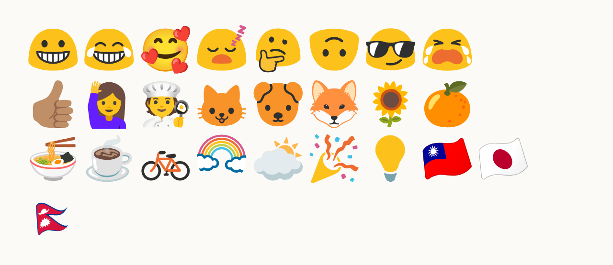

# Bahuan

Bahuan is a color emoji font that brings back Google's **blob** emoji. It picks,
emoji by emoji, from the published eras of [Noto Emoji][noto] art: blob faces
from Android 7.1, flat objects from Android 7.x and the Android 12 refresh,
and the waved Android 7.1 flags.



## Install

Download the fonts from the [latest release][releases].

| Platform | File |
|---|---|
| Linux, Android | `Bahuan-CBDT.ttf` (or `Bahuan-COLRv1.ttf` for recent FreeType) |
| macOS, iOS | `Bahuan-sbix.ttf` |
| Windows 11, browsers | `Bahuan-COLRv1.ttf` |
| Firefox, Safari, Adobe apps | `Bahuan-SVG.ttf` |
| Web pages | `Bahuan-COLRv1*.woff2` with `bahuan.css` |

**Linux.** Copy the font to `~/.local/share/fonts/` and prefer it for emoji
in `~/.config/fontconfig/fonts.conf`:

```xml
<?xml version="1.0"?>
<!DOCTYPE fontconfig SYSTEM "fonts.dtd">
<fontconfig>
  <alias binding="strong">
    <family>emoji</family>
    <prefer><family>Bahuan</family></prefer>
  </alias>
  <match target="pattern">
    <test name="family"><string>Noto Color Emoji</string></test>
    <edit name="family" mode="assign" binding="strong"><string>Bahuan</string></edit>
  </match>
</fontconfig>
```

Then run `fc-cache -f`.

**macOS.** Open `Bahuan-sbix.ttf` and click *Install Font*. It installs as a
user font: apps that let you pick a font (TextEdit, Pages, web pages that ask
for it) can use it, but it can't replace Apple Color Emoji system-wide.

**Windows.** Right-click `Bahuan-COLRv1.ttf` → *Install*. Apps that use the
system emoji font keep Segoe UI Emoji; pick Bahuan where you can choose a
font.

**Web.** Serve the woff2 files with `bahuan.css` and add `"Bahuan"` to your
font stack after your text fonts (`font-family: system-ui, "Bahuan"`): like
every emoji font, it maps digits, `#` and `*` to blank keycap bases.

## Build

```sh
uv sync
make
```

The first run fetches upstream art (a blob-less clone of noto-emoji, several
minutes). Fonts land in `build/out/`. `steamer` picks the era for each emoji
from `selection/selection.toml`; run `uv run steamer --help`.

See [DECISIONS.md](DECISIONS.md) for the plan and the reasoning behind each
choice.

## License

Code and art: [Apache-2.0](LICENSE). Fonts: [OFL-1.1](OFL.txt).
The art is Google's Noto Emoji; see [AUTHORS](AUTHORS).

[noto]: https://github.com/googlefonts/noto-emoji
[releases]: https://github.com/rschiang/bahuan/releases
